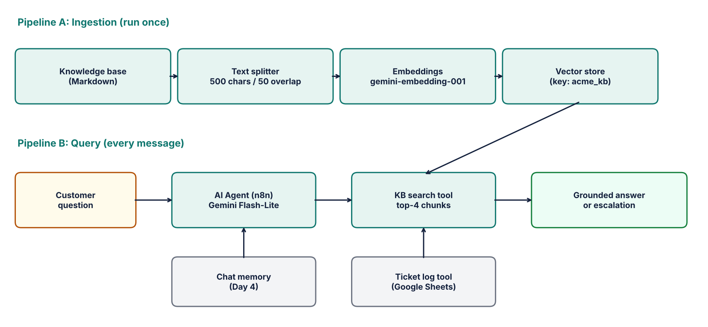

# rag-to-hero: AI Customer Support Agent (n8n + RAG)

A customer support chatbot built in **n8n** that answers questions from a company knowledge base using **Retrieval-Augmented Generation (RAG)** instead of guessing. Built as a hands-on learning project with a fully free stack (no credit card).



> **Status: in progress.** Items are checked off as they are completed and tested. See [Roadmap](#roadmap).

## The problem

A plain LLM answers confidently even when it does not know. Asked about a store's return policy, my first version invented one. For customer support, a wrong answer is worse than no answer. This project grounds the model in real documents, makes it admit when it does not know, and hands off to a human when it cannot help.

## How it works

**Pipeline A: Ingestion (run once, or when documents change)**
1. Upload the knowledge base file through an n8n form
2. Extract the text
3. Split into 500-character chunks with 50 characters of overlap
4. Embed each chunk with `gemini-embedding-001`
5. Store the vectors in n8n's Simple Vector Store under the key `acme_kb`

**Pipeline B: Query (every customer message)**
1. The Chat Trigger receives the question
2. The AI Agent (Gemini Flash-Lite, low temperature) decides to call the `acme_knowledge_base` tool
3. The tool embeds the question and returns the top 4 closest chunks
4. The agent answers using only those chunks, or says it does not know and points to human support

## Tech stack

| Layer | Choice |
|---|---|
| Orchestration | n8n (self-hosted, Docker) |
| LLM | Google Gemini Flash-Lite (free tier) |
| Embeddings | `gemini-embedding-001` |
| Vector store | n8n Simple Vector Store (in-memory, development only) |
| Knowledge base | Synthetic "Acme Gadgets" FAQ, policies, products, troubleshooting |
| Runtime | Docker Desktop |

## Screenshots

<!--Add your own screenshots to `assets/screenshots/` and keep the ones that apply.--> 

| What | File |
|---|---|
| Ingestion workflow canvas | `assets/screenshots/ingestion-workflow.png` |
| Agent workflow canvas (agent + tool + model) | `assets/screenshots/agent-workflow.png` |
| Chat: correct answer from the KB | `assets/screenshots/chat-grounded-answer.png` |
| Chat: "I don't know" on an out-of-scope question | `assets/screenshots/chat-refusal.png` |
| Execution log showing the tool call and returned chunks | `assets/screenshots/execution-trace.png` |

<!-- Uncomment once the files exist:


-->

## Quick start

**Prerequisites:** Docker Desktop, a Google account (free Gemini API key from [aistudio.google.com](https://aistudio.google.com)).

```bash
# 1. Run n8n with a persistent volume
docker volume create n8n_data
docker run -d --name n8n -p 5678:5678 -v n8n_data:/home/node/.n8n docker.n8n.io/n8nio/n8n

# 2. Open http://localhost:5678 and create the local owner account
```

3. Add a **Google Gemini** credential with your API key
4. Import the workflows from `workflows/` (see `workflows/README.md`)
5. Run the ingestion workflow and upload `data/acme-gadgets-knowledge-base.md`
6. Open the agent workflow, click **Open chat**, and ask: *How long do I have to return a laptop?*

> The vector store lives in memory. If the container restarts, re-run ingestion.

## Evaluation

The agent is scored on a 12-question test set (8 in the knowledge base, 3 not in it, 1 off-topic) plus 4 robustness tests (prompt injection, system prompt extraction, false premise, out-of-policy request).

| Version | Description | Score |
|---|---|---|
| v1 | Plain LLM, no knowledge base | _/12 |
| v2 | KB tool + grounded system prompt | _/12 |
| Final | After tuning | _/12 |

Full question list and results: [`docs/evaluation.md`](docs/evaluation.md).

## What went wrong and how I fixed it

| # | Problem | Cause | Fix |
|---|---|---|---|
| 1 | `localhost:5678` showed "Unable to connect" even though the n8n logs said the editor was running | The container was started without publishing the port (and without the data volume), so the editor was reachable only inside Docker | Removed the container and recreated it with `-p 5678:5678 -v n8n_data:/home/node/.n8n` |
| 2 | Agent invented a return policy on day 1 | No knowledge base; the LLM answered from memory | Added the RAG pipeline and a system prompt restricting answers to retrieved context |
| 3 | Knowledge base search returned nothing after restarting n8n | Simple Vector Store is in-memory only and is cleared on restart | Re-run the ingestion workflow; for production, switch to a persistent store such as Qdrant |
| 4 | Retrieval returned wrong or no chunks | Embedding model on search did not match the model used at ingestion | Used `gemini-embedding-001` on both sides. Vectors from different models are not comparable |
| 5 | Duplicate chunks after running ingestion twice | Store was not cleared between runs | Enabled **Clear Store** on the insert node |
| 6 | Off-topic questions still returned "relevant" chunks | Vector search always returns the nearest results, even if none are relevant | Added an explicit rule: answer only from context, otherwise say you do not know |
| | _..._ | | |

## Limitations

- In-memory vector store: not persistent, not for production
- Small synthetic knowledge base (about 1,200 words)
- Free-tier rate limits; Google may use free-tier requests to improve its products, so no private data
- No authentication or user separation

## Roadmap

- [x] n8n running locally in Docker
- [x] Chat agent connected to Gemini
- [x] Synthetic knowledge base written
- [ ] Ingestion workflow built and verified
- [ ] Agent connected to the knowledge base as a tool
- [ ] 12-question evaluation scored and recorded
- [ ] Conversation memory
- [ ] Ticket-logging tool for human escalation
- [ ] Demo video
- [ ] Persistent vector store (Qdrant)

## What I learned

- RAG separates two failure types: *retrieval* (wrong chunks returned) and *generation* (right chunks, bad answer). Check the tool output before rewriting prompts.
- Chunk size is a trade-off: too small loses context, too large mixes topics.
- Embedding model must match between ingestion and search.
- Always test questions the knowledge base cannot answer, not just ones it can.

## Repository layout

```
rag-to-hero/
├── data/            knowledge base documents
├── prompts/         system prompt and tool description
├── workflows/       exported n8n workflow JSON
├── docs/            evaluation scorecard
├── assets/          architecture diagram and screenshots
└── README.md
```

## License

MIT
